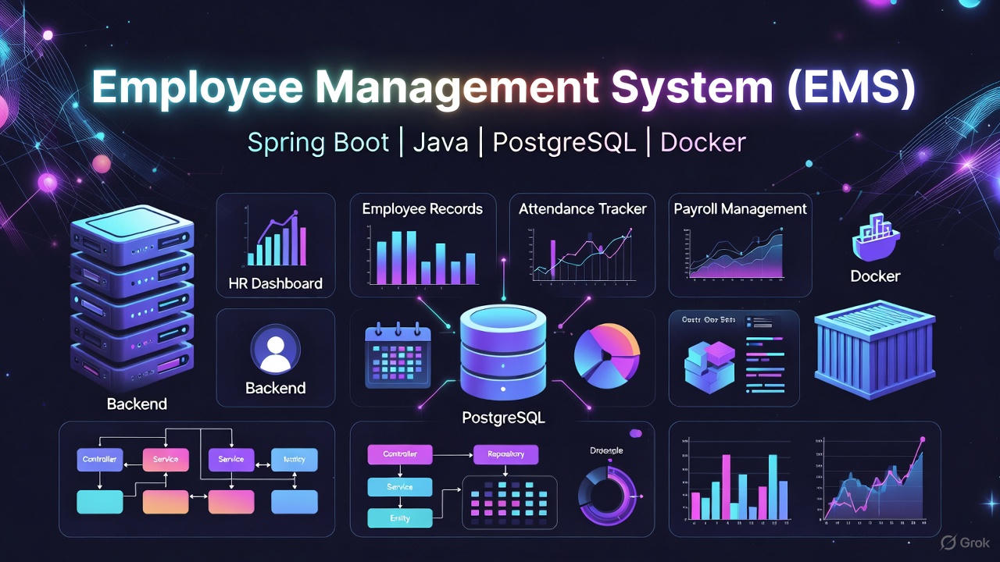
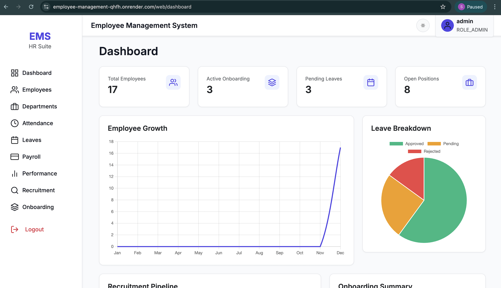
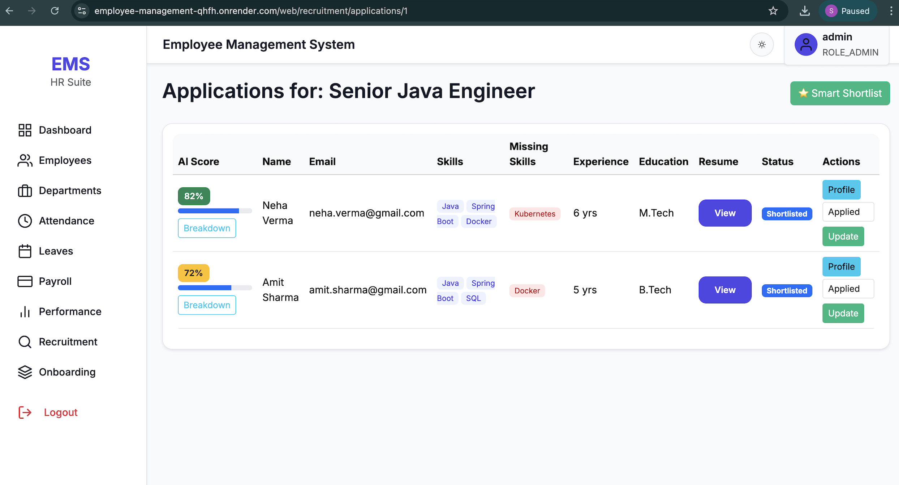
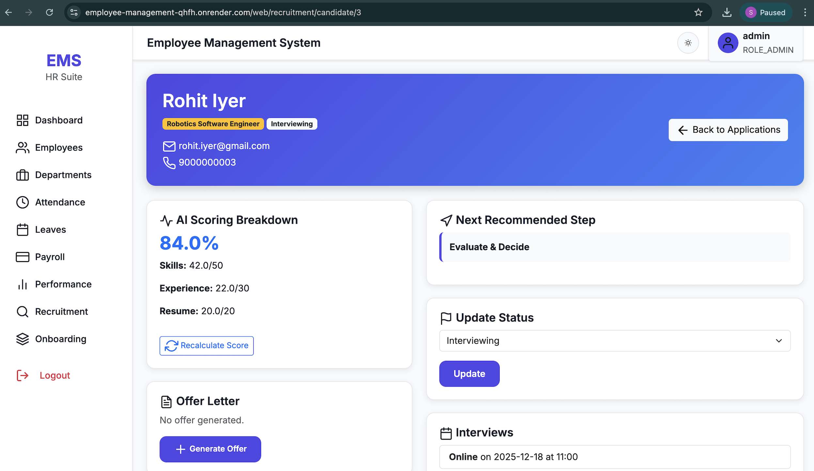
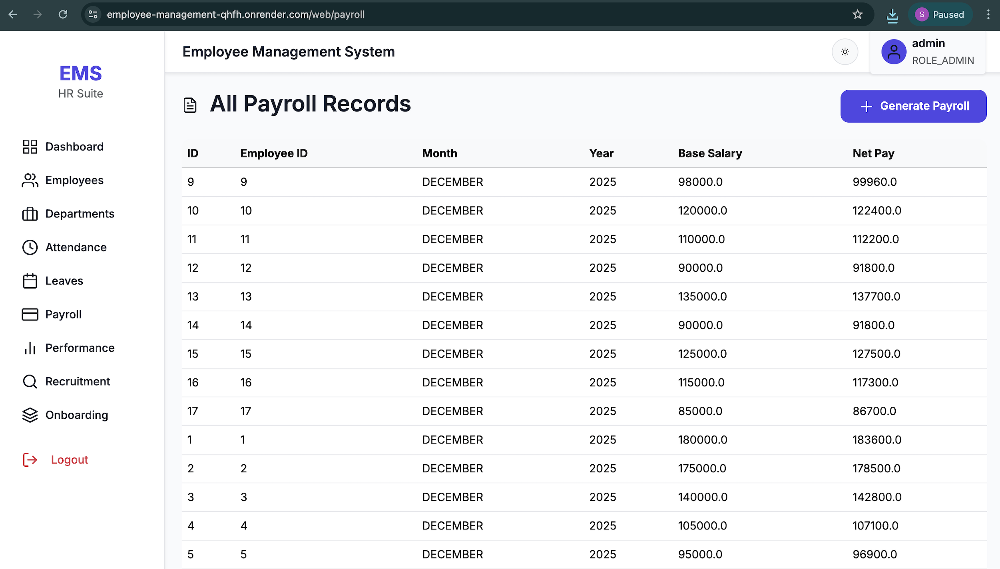
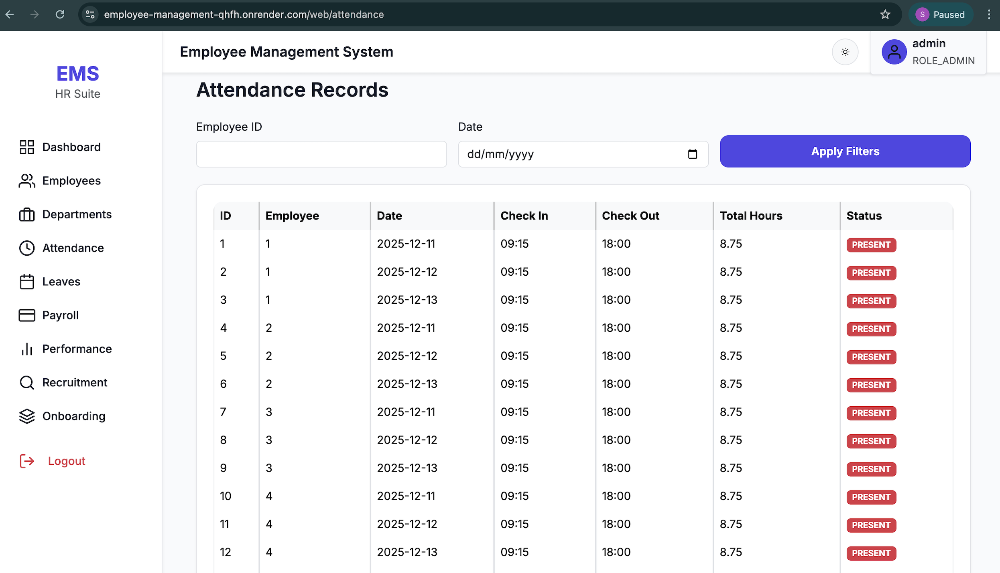
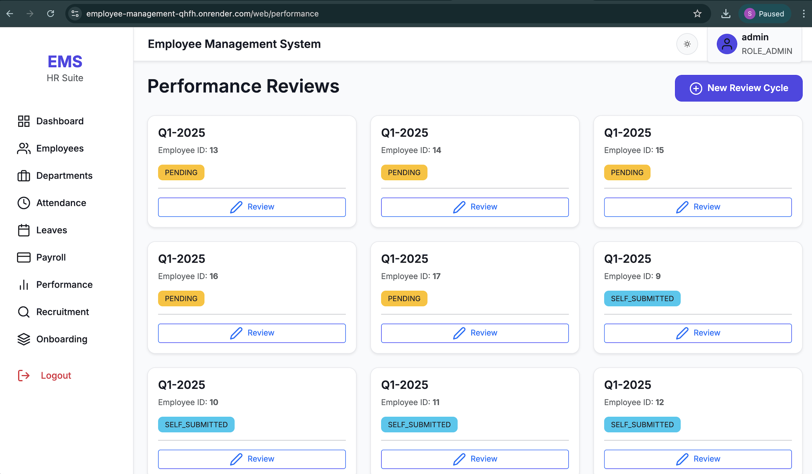
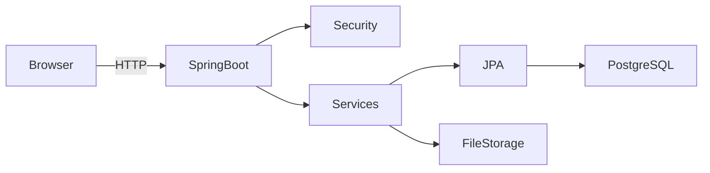
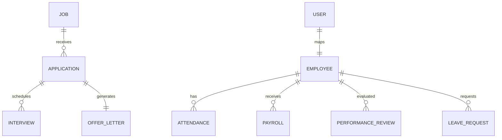

<p align="center">
  
</p>

# 🚀 Employee Management System (EMS) 


[](https://employee-management-qhfh.onrender.com)


An **Employee Management System (EMS)** built with **Spring Boot, Thymeleaf, Spring Security, and PostgreSQL (Neon)**, deployed on **Render**.

The platform demonstrates employee lifecycle workflows — recruitment, onboarding, attendance, leave management, payroll, performance reviews, and analytics — in a modular Spring application. It is a portfolio/demo project and has not yet been independently security- or production-validated.


🌐 **Live Deployment**: https://employee-management-4yjm.onrender.com

---

## 📌 Table of Contents
- [Overview](#overview)
- [User Roles](#user-roles)
- [Key Features](#key-features)
- [Screenshots](#screenshots)
- [Architecture](#architecture)
- [Technology Stack](#technology-stack)
- [Project Structure](#project-structure)
- [Security](#security)
- [API Documentation](#api-documentation)
- [Docker & Deployment](#docker--deployment)
- [CI/CD Pipeline](#cicd-pipeline)
- [Environment Configuration](#environment-configuration)
- [Running Locally](#running-locally)
- [License](#license)

---

## 🧠 Overview

The **Employee Management System (EMS)** is designed as a **real‑world HRMS platform**.

It supports:
- Secure role‑based access
- AI‑assisted recruitment scoring
- End‑to‑end employee lifecycle management
- Real analytics dashboards
- Docker and GitHub Actions build workflow

---

## 👥 User Roles

| Role | Capabilities |
|-----|-------------|
| **Admin** | Full system access, users, departments, payroll, analytics |
| **HR** | Recruitment, onboarding, attendance, performance, leave |
| **Employee** | Self‑service: attendance, payroll, leave, performance |

---

## ✨ Key Features

### 🧑‍💼 Employee Management
- Create, update, soft‑delete & restore employees
- Department & role management
- Search, filter & pagination

### 🧠 Recruitment & Resume Heuristics
- Job postings & public careers page
- Resume upload & parsing (PDF)
- Heuristic resume scoring & missing skills detection (not an AI model)
- Smart shortlisting
- Interview scheduling
- Offer letter PDF generation
- Convert hired candidates → employees
- Automatic onboarding trigger

### 🧾 Attendance & Leave
- Clock‑in / clock‑out
- Attendance analytics
- Leave application & approval workflow
- Leave balance tracking
- Calendar & reports (PDF / Excel)

### 💰 Payroll
- Monthly payroll generation
- Salary breakdown
- Mark payroll as paid
- Employee self‑view

### 📊 Performance Management
- Review cycles (Q1, H1, Yearly)
- Self review & manager review
- Final score calculation

### 🚀 Onboarding
- Template‑based onboarding flows
- Task assignment & tracking
- File uploads

### 📈 Dashboards & Analytics
- Employee growth trends
- Salary distribution
- Department analytics
- Recruitment funnel insights

---

## 🖼 Screenshots

> Screenshots are stored under `docs/screenshots/`

| Module | Preview |
|------|--------|
| Dashboard |  |
| Recruitment |  |
| Candidate Profile |  |
| Payroll |  |
| Attendance |  |
| Performance Review |  |

---

## 📐 System Architecture



### Architecture Highlights
- MVC + Service + Repository
- Spring Security (RBAC)
- JPA + Hibernate
- Flyway (Dev)
- Dockerized runtime

---

## 🗄️ ER Diagram (Database Schema)



---

## 🛠 Technology Stack

| Layer | Technology |
|-----|-----------|
| Backend | Java 17/21, Spring Boot |
| Security | Spring Security, BCrypt |
| Frontend | Thymeleaf, HTML, CSS |
| Database | PostgreSQL (Neon), H2 (dev) |
| ORM | Spring Data JPA |
| Resume processing | PDF text extraction and rule-based scoring |
| Build | Maven |
| DevOps | Docker, Docker Compose |
| CI/CD | GitHub Actions |
| Hosting | Render |

---

## 🗂 Project Structure

```text

src/main/java/com/empmgmt
├── controller
├── service
│   └── impl
├── repository
├── model
├── security
├── util
└── config

```

Resources:

```text

src/main/resources
├── templates
├── static/css
├── application.properties
├── application-dev.properties
└── application-prod.properties

```

---

## 🔐 Security

- Spring Security form‑based authentication
- Role‑based authorization
- CSRF protection (Cookie‑based)
- Password hashing with BCrypt
- No-email employee password setup using an HR-issued, single-use code
- Secure file uploads
- Auditing (createdBy / updatedBy)

---

## 📘 API Documentation

- Swagger UI: `/swagger-ui.html`
- OpenAPI JSON: `/v3/api-docs`
- Detailed REST documentation: **[api.md](api.md)**

---

## 🐳 Docker & Deployment

### Dockerfile
Multi‑stage build:
- Maven build stage
- Lightweight JRE runtime stage

### Docker Compose Files
| File | Purpose |
|----|--------|
| docker-compose.yml | Local development |
| docker-compose.prod.yml | Production |
| docker-compose.test.yml | CI / testing |

Compose keeps uploaded files in a named volume. Render Free web services have ephemeral filesystems, so uploaded resumes and onboarding files can disappear on restart or redeploy. This demo does not provision paid persistent storage or an external object-storage service.

Employee account setup does not send email: HR generates a one-time code in the employee list and gives it to the employee directly. The code expires after 24 hours and is stored only as a hash. Keep the code private.

Automatic production schema changes remain disabled for both Hibernate and Flyway. The live Neon schema has no Flyway history and differs from `V1__initial_schema.sql`. The two nullable account-setup columns from V2 were applied manually to the existing Neon `users` table on 2026-10-28. Do not enable Flyway until a baseline and migration plan are prepared for the existing database.

---

## 🔁 CI/CD Pipeline

GitHub Actions:
- Java 17 & 21 matrix builds
- Maven verification lifecycle and artifact upload

The repository currently has no automated test sources. CI builds the project but does not provide behavioral test coverage.

Workflow file:
```
.github/workflows/ci.yml
```

---

## 📂 Monorepo‑Grade Docs Index

- [API Reference](./api.md)
- [System Architecture](./architecture.md)
- [Database Design](./database.md)

---

## ⚙️ Environment Configuration

`.env.example`
```env
SPRING_DATASOURCE_URL=jdbc:postgresql://...
SPRING_DATASOURCE_USERNAME=postgres
SPRING_DATASOURCE_PASSWORD=secret
SPRING_PROFILES_ACTIVE=prod
```

##  Environment Profiles

| Profile | DB | Usage |
|------|----|------|
| dev | In-memory H2; Hibernate creates the local demo schema | Local |
| prod | Neon PostgreSQL; schema changes disabled pending a reviewed migration plan | Render |

---

## ▶️ Running Locally

### Option 1: Maven

```bash
SPRING_PROFILES_ACTIVE=dev mvn clean package
SPRING_PROFILES_ACTIVE=dev java -jar target/employee-management-2.0.0.jar
```

### Option 2: Docker

```bash
docker-compose up --build
```

App runs at:

```
http://localhost:8080
```

---

## 📄 License

MIT License © 2025 

---

If you like this project, please ⭐ the repository!
